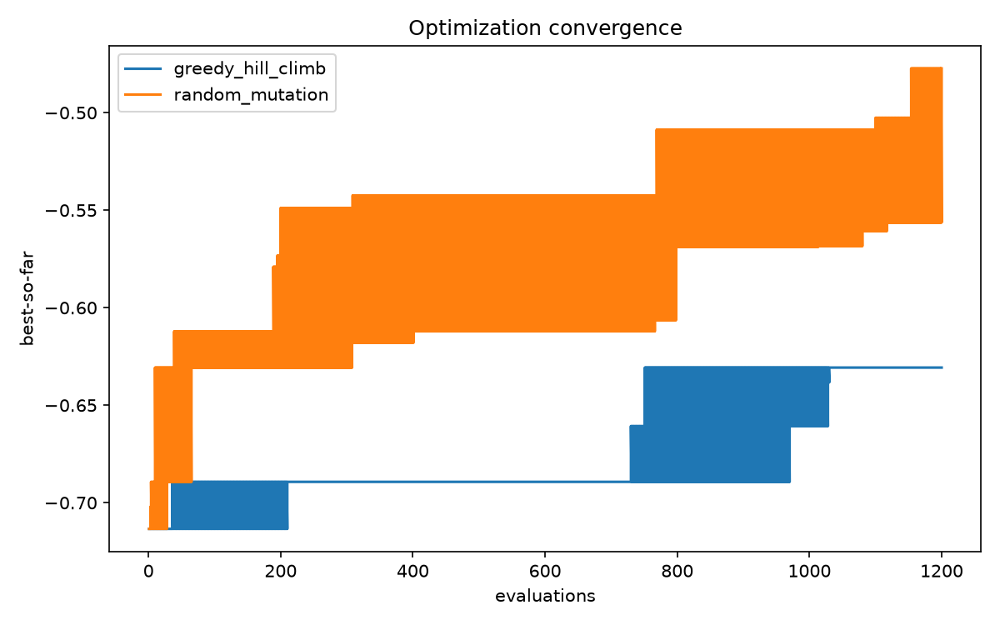

# GV02-04 中期报告（M3）

## 1. 优化收敛（模块4）

| 策略/预算/seed | 最终 best-so-far |
|---|---|
| random_mutation / 1200 / 44 | -0.4773 |
| random_mutation / 1200 / 42 | -0.5203 |
| random_mutation / 1200 / 46 | -0.5216 |
| random_mutation / 1200 / 45 | -0.5424 |
| random_mutation / 600 / 44 | -0.5424 |
| random_mutation / 600 / 45 | -0.5424 |
| random_mutation / 300 / 44 | -0.5489 |
| random_mutation / 1200 / 43 | -0.5563 |
| random_mutation / 300 / 46 | -0.5689 |
| random_mutation / 600 / 46 | -0.5689 |
| random_mutation / 300 / 42 | -0.6121 |
| random_mutation / 600 / 42 | -0.6121 |
| random_mutation / 600 / 43 | -0.6121 |
| random_mutation / 300 / 43 | -0.6179 |
| greedy_hill_climb / 1200 / 42 | -0.6307 |
| greedy_hill_climb / 1200 / 43 | -0.6307 |
| greedy_hill_climb / 1200 / 44 | -0.6307 |
| greedy_hill_climb / 1200 / 45 | -0.6307 |
| greedy_hill_climb / 1200 / 46 | -0.6307 |
| random_mutation / 300 / 45 | -0.6307 |
| greedy_hill_climb / 300 / 42 | -0.6893 |
| greedy_hill_climb / 300 / 43 | -0.6893 |
| greedy_hill_climb / 300 / 44 | -0.6893 |
| greedy_hill_climb / 300 / 45 | -0.6893 |
| greedy_hill_climb / 300 / 46 | -0.6893 |
| greedy_hill_climb / 600 / 42 | -0.6893 |
| greedy_hill_climb / 600 / 43 | -0.6893 |
| greedy_hill_climb / 600 / 44 | -0.6893 |
| greedy_hill_climb / 600 / 45 | -0.6893 |
| greedy_hill_climb / 600 / 46 | -0.6893 |

## 2. 约束验证（代码1）

- 序列数: 30
- 快速判定通过: 30
- Pfam(PF00741) 通过: 0

## 3. 副作用分析（代码2）

- 序列数: 30
- 无副作用(OK): 0
- 存在副作用: 30

## 4. 收敛曲线

